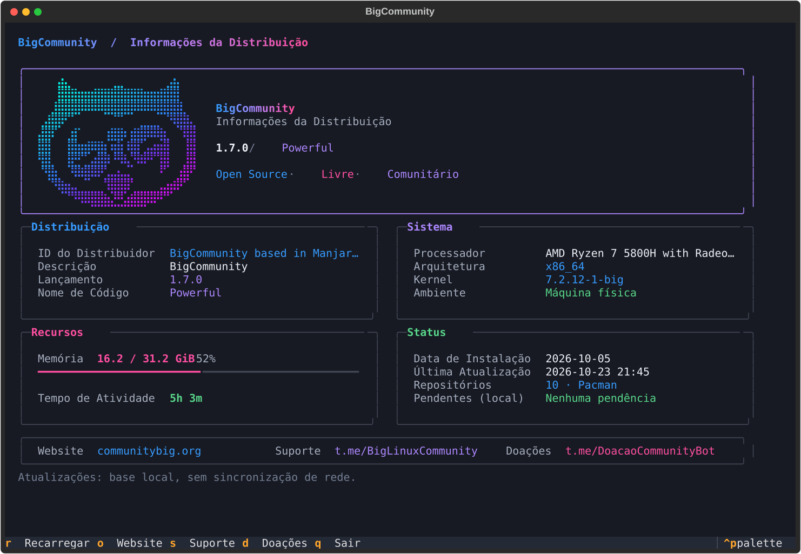

# community-release

BigCommunity distribution identity, terminal dashboard and GTK information window.



`comm-release` prints a responsive dashboard and returns to the shell. The new
owl is pre-rendered in braille using the distribution logo's original gradient.
The default screen uses Rich; no image conversion runs at startup.

```sh
comm-release             # Snapshot: distribution, system, resources and status
comm-release --tui       # Interactive dashboard (optional python-textual)
comm-release -rs         # Release only, without loading either UI
comm-release -as         # All identity fields as plain text
comm-release -e          # Detailed system information, with wrapped values
comm-release --help
comm-release-gtk
```

In the TUI: `r` reloads local data, `o` opens the website, `s` opens support,
`d` opens donations, and `q` / Escape exits. The screen scrolls on short
terminals and switches to stacked cards on narrow ones. No link opens on startup.
Memory and uptime are refreshed when `r` is pressed.

The distribution identity appears before package queries. Update counts use the
existing local package database (`pacman -Qu`); opening the dashboard never runs
`checkupdates`, synchronizes repositories, or installs packages. Counts may be
outdated until repositories are synchronized outside this tool. Query errors
and timeouts are shown as unavailable rather than zero updates.

For a local preview, including on a system with another version installed:

```sh
make
./usr/bin/comm-release
./usr/bin/comm-release --tui
```

The locale builder needs GNU gettext (`msgfmt`). Rich is required; Textual is
optional and imported only for `--tui`. The installed system's identity files
remain the source of truth even when running from a checkout.

Development follows the same workflow as Big AI Agents:

```sh
make                    # Build translation catalogs
make check              # Check translations, shell syntax and offline tests
make po                 # Extract source strings and merge existing catalogs
make pkg                # Build an Arch package from the clean, committed tree
```

TUI tests are skipped if Textual is not installed. The suite checks short-output
compatibility, identity rendering before slow probes, update errors, widths from
32 to 120 columns, Portuguese catalogs, checkout launchers, and interactive
refresh, resize, links and shutdown. The CI container includes Textual so those
tests always run there.

`make pkg` uses the production PKGBUILD with a checksummed archive of the current
commit. Packages and their `SOURCE-REVISION` record go under `build/<commit>/`.
It does not install packages, synchronize repositories or publish anything.
The distribution keeps its existing 1.7.0 Powerful identity; the information tool
is versioned independently (2.1.0).

English is the source language. The new interface is translated in Portuguese;
other existing catalogs retain their translations and fall back to English for
new messages that have not been reviewed. See the [decisions](docs/decisions.md),
[manual test plan](tests/manual/README.md) and [changelog](CHANGELOG.md).
